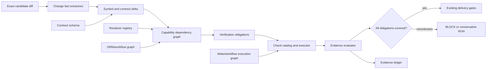

# Change Impact Driven Verification · 设计方案 v1

## 0. 状态与裁决边界

本文件是 P4-00 的审查输入，不是已经落地的门禁方案。

当前 PR 只允许：

- 建立验证体系全量盘点、执行图和成本基线。
- 提出变更影响驱动的验证架构、对象模型、判定算法与八批落地计划。
- 增加只读审计器和审计文档。

当前 PR 不允许：

- 修改 `config/ci/path_ownership_v1.json`、`config/acceptance/evolution_binding.v1.json`
  或任何现有必需门禁的判断结果。
- 修改产品契约、Decoder、Renderer、页面、ACL、ORM、业务状态或测试断言。
- 执行数据库升级、fixture reset、浏览器验收或生产操作。
- 在方案审查合格前创建新的强制门禁或替换现有需要执行的检查。

## 1. 盘点结论

P4-00 的机器证据见：

- `verification_system_inventory.md`
- `verification_mapping_matrix.json`
- `verification_execution_graph.json`
- `verification_cost_baseline.json`
- `impact_analysis_acceptance_matrix.json`

当前实测：

- 10 个 GitHub workflow，23 个 job。
- 4 个 gate anchor。
- 原 lane 仪器得到 245 个 anchor 可达节点；归一化后是 239 个真实 Make target，
  多出的 6 个是变量形状节点，不是 Make 规则。
- 539 个从 gate 目标实际引用到的源代码、测试、guard、工具或 fixture 文件。
- guard registry 共 1,605 个脚本生命周期条目；其中 247 个 gate-enforced，
  1,097 个是 manual/non-gate dispatch，169 个只有文件引用，92 个 orphan。
- 671 个 Make target 当前零引用；这些 target 不构成自动验证覆盖。
- 22 个 target 的 recipe 引用了仓库内不存在的资产；这些 target 不能运行。

结构性问题不是“验证太多”或“验证太少”这么简单，而是同时存在：

1. **过度触发（已由 #906 部分修正）**：在审查基线 `3c768264` 上，契约
   Schema/Decoder 路径命中 `frontend_presentation`，从而要求真实页面证据。最新 main
   `730b82cf` 已出现 `frontend-contract-v2-codec`：`schema.ts` 和
   `legacyLayoutNormalizer.ts` 现在只命中 `frontend_contract` 且无 presentation evidence。
   这验证了分层方向，但不代表通用影响引擎已经实现或完成。
2. **欠触发仍存在**：Renderer registry 仍只命中通用 `frontend_contract`，没有自动要求页面
   呈现证据。
3. **证明错位**：父 workflow、结构扫描、HTTP 200、元素可见、历史 PASS 都容易被描述成比实际
   更大的产品结论。
4. **长尾失联**：大量手工验收脚本存在，但不在 gate graph；不能因为脚本名为 `acceptance` 或
   `browser` 就视为自动门禁。
5. **复用边界分散**：run receipt、acceptance evidence、unit ledger、Quick receipt 和 backend
   receipt 各自绑定不同输入；没有统一的“变更影响 → 验证义务 → 证据”对象。

P4-00 盘点本身的证据等级也必须明确：

- workflow/Make/registry 的直接声明边属于 observed declaration。
- 脚本 docstring/header 中的验证用途属于 declared metadata。
- 资源、层和共享脚本属于 static inference，不是运行时证明。
- 实际 assertion、传递调用、动态注册、真实服务依赖和重复覆盖仍为 UNKNOWN。
- `duplicate_or_overlap=[]` 不得解释为“没有重复验证”；P4-00 尚未建立 assertion 级关联。

因此 P4-00 只能证明“调用面、门禁面、证据边界和主要结构缺陷已经被看见”；不能证明
“539 个执行文件的验证责任已经全部准确识别”。后者是 P4-01/P4-02 的退出条件。

## 2. 设计目标

Change Impact Driven Verification 的目标只有一个：

> 根据候选实际改变的契约语义、呈现行为和业务执行影响，自动选择最小充分验证集合，并证明
> 每个相关风险都有当前候选的有效证据。

三个不可变原则：

1. 不相关的验证不执行。
2. 相关的验证必须有证据。
3. 未覆盖的风险不能通过路径分类或历史 PASS 自动放行。

设计不追求“减少测试数量”本身。减少执行是正确影响分析的副产品；不能为了减少而缩小断言、
跳过负例或把 `unknown` 当 `NOT_APPLICABLE`。

### 2.1 三个身份

系统必须同时保留三个不同的身份，禁止混写：

| 身份 | 作用 | 不能承担 |
| --- | --- | --- |
| `main_head` | 当前集成目标和 PR base | 不能自动成为已验证基线 |
| `verified_baseline` | 最近一次通过完整义务覆盖、独立审查、受保护合并和 main 回读的稳定证明点 | 不替代当前候选的 delta 证明 |
| `candidate_head/tree` | 当前要验证和交付的对象 | 不能继承未匹配输入的旧 PASS |

候选规划不是“candidate diff 对 main 一次全量”，而是：

```text
candidate = verified_baseline + inherited_unverified_delta + candidate_delta
```

- `inherited_unverified_delta`：verified baseline 之后已进入 main、但尚未被提升入基线证明的变更。
- `candidate_delta`：当前分支相对其 main merge-base 的变更。
- 两段 delta 都用同一语义影响模型逐 unit 展开；不能因为 main 已经合并就免于证明，也不能因为
  基线落后就自动全量重跑。

### 2.2 Stable Baseline Record

稳定基线不是单个 SHA，而是一份可验证记录：

```json
{
  "schema": "change_impact_verification.baseline.v1",
  "source": {"head": "...", "tree": "..."},
  "base_main": "...",
  "proofs": [
    {
      "obligation_id": "...",
      "check_id": "...",
      "input_fingerprint": "sha256:...",
      "assertion_set_sha256": "sha256:...",
      "toolchain_sha256": "sha256:...",
      "environment_identity": {"profile": "...", "database": "...", "artifact": "..."},
      "evidence_authority": "...",
      "evidence_sha256": "sha256:..."
    }
  ],
  "coverage": {
    "required_obligations": 0,
    "passed": 0,
    "reused": 0,
    "not_applicable": 0,
    "unknown": 0,
    "blocked": 0
  },
  "promotion": {
    "candidate_head": "...",
    "merged_main_head": "...",
    "main_tree_equivalent": true,
    "independent_review": "approved",
    "remote_checks": "passed"
  }
}
```

基线的有效性按 obligation/check 的输入指纹判断，不只按 source SHA。这样一个新的 main
提交不会把全部证明一起作废；只会让受影响 unit 进入 RUN/BLOCK。

### 2.3 Delta 与复用代数

对每个义务 `o`：

```text
fingerprint(o) =
  changed semantics
  + producer/consumer identity
  + assertion identity
  + tool identity
  + environment identity
```

决策：

```text
if o not touched by any delta:
    REUSE baseline proof when evidence is intact and environment-compatible
elif o touched and matching proof exists:
    REUSE only by an authorized evidence engine
elif o touched and no matching proof:
    RUN the smallest sufficient checks
else:
    BLOCK
```

关键约束：

- 基线 unit 没有完整 input declaration 时不能复用，只能 RUN/BLOCK。
- 一个文件变化不必使该文件所有义务失效；symbol/contract field/consumer 级指纹决定失效。
- 一个义务的断言、adapter、工具、fixture 或环境变化必须使其旧证据失效。
- 运行时证据不能从从未运行的 unit、旧部署或另一个数据库继承。
- `NOT_APPLICABLE` 必须由 delta 语义和反向条件证明，不能由基线曾经没有执行该项推断。

### 2.4 基线推进

基线只允许在以下条件同时满足时推进：

1. clean、精确 candidate HEAD/tree。
2. 所有 required obligation 已 passed、authorized reused 或 justified N/A。
3. `unknown=0`、`blocked=0`。
4. 断言、工具、环境、evidence digest 完整。
5. 独立复核通过。
6. 当前 source/base 的 required remote checks 通过。
7. 通过受保护 PR 合并，并回读 merged main。
8. merged main tree 与已证明 candidate tree 等价；不等价时重新计算 delta 和受影响义务。

基线推进本身不执行浏览器或全量测试。它只验证候选证据、main 树等价、身份和覆盖方程，然后
原子移动 `verified_baseline` 指针。这样每个已合并候选都能把证明变成下一次迭代的起点，而不是
不断累积相对一个长期旧基线的 diff。

基线回滚只移动指针并标记后续证据 stale；不能改写旧回执。代码 revert、数据 revert 和环境
回滚仍分别验证。

### 2.5 高效增量迭代

效率来自减少重复工作和缩短关键路径，不来自降低断言质量。

#### 检查选择

- 先按 oracle 精度选择：成本相近时选能直接证明目标行为的检查。
- 再按成本选择：同精度时选最早、最短、诊断最具体的检查。
- `one execution -> many obligations` 的检查只执行一次，并显式登记覆盖的义务。
- `one obligation -> many checks` 时做集合覆盖，选满足最小断言集合的最低成本组合。
- 同一 source、toolchain、fixture 和环境下的构建、安装、编译、扫描只执行一次。
- 不重复安装已 hash 一致的依赖，不重复启动同一个受管环境，不重复执行被同一 target 闭包
  覆盖的子检查。

#### 分层反馈

| 反馈阶段 | 默认范围 | 目标 | 禁止扩张 |
| --- | --- | --- | --- |
| inner loop | changed symbols + direct consumers | 秒到分钟级语法、契约、单测反馈 | 不建验收库、不跑全浏览器 |
| L1 | schema/decoder/producer/consumer | 契约最小充分集合 | presentation 风险未出现时不跑页面 |
| L2-unit | renderer/component/interaction | 受影响组件和页面模型 | 未触及真实页面时不启动浏览器 |
| L2-browser | affected page/role/viewport units | 只执行受影响页面身份 | 不用页面总数驱动全矩阵 |
| L3 | affected module/method/tag/journey | 真 ORM/权限/业务结果 | 不启动无关模块、升级或数据库 |
| L4 | static/build/security/release | 当前交付风险 | 不把 L4 当产品层 |
| candidate | explicit frozen candidate | 发布资格 | 不塞入普通 inner loop |

#### 执行调度

- 独立静态/单元检查可并行；共享数据库写入、fixture、端口、卷、环境准备串行。
- 先跑最早能失败的 owning-layer 检查；失败后不启动下游昂贵检查。
- 有依赖的义务按 DAG 串行；无依赖义务按资源预算并发。
- shard 只用于恢复粒度和并行关键路径，不能改变覆盖集合。
- 如果增量预算超限，先生成 reviewable plan，再决定保守 RUN 或 BLOCK；不能静默全量。

#### 可复用缓存层

| 缓存层 | 复用键 | 说明 |
| --- | --- | --- |
| semantic plan | graph/tool/schema/delta fingerprints | 同一输入复现同一计划 |
| dependency/toolchain | lockfile/install graph/executable digests | 安装或编译一次 |
| static check | source + tool + config | 离线 guard 的输入等价可复用 |
| unit/component | test inputs + assertions + runtime | 不复用未知依赖 |
| browser | page/role/viewport units + served artifact + backend identity | 增量 unit evidence |
| ORM | module/tags/test graph + image/runtime + contract/fact readback | 未闭合依赖不复用 |
| release artifact | exact build source/tree + build inputs | bundle/provenance 可复用 |

### 2.6 效率目标

以下是设计审查时建议确认的预算，不是当前实测承诺：

| 候选类型 | 目标反馈时间 | 必须避免 |
| --- | ---: | --- |
| docs/metadata | ≤ 60 秒 | 产品构建、ORM、浏览器 |
| contract-only decoder/schema | ≤ 3 分钟 | 完整页面矩阵、数据库升级、无关模块 |
| renderer/component unit | ≤ 5 分钟 | 全量 backend suite |
| targeted page interaction | ≤ 8 分钟 | 无页面消费的全仓浏览器 |
| targeted ORM/business | ≤ 12 分钟 | 无关模块、重复建库、无关升级 |
| frozen candidate | 显式全候选预算 | 把 candidate 成本压到普通 PR 的 inner loop |

预算由 lane telemetry 的真实 duration、资源占用、复用率和 unknown/false-skip 数据持续校准。
达不到预算时先消除重复执行和错误分类，不先删测试。

### 2.7 日常增量迭代闭环

每次开发循环按以下顺序执行：

1. 解析 `main_head`、`verified_baseline` 和当前 candidate；三身份不完整则 reconcile。
2. 将已提交、staged、unstaged、untracked 变更合并成当前 worktree delta，并保留 rename 两端。
3. 用 semantic graph 把 delta 展开为 obligation；未被 delta 触及的 baseline proof 不重跑。
4. 先跑最早能失败的 L1/静态检查，只启动该 delta 的 L2/L3。
5. 失败时只修复 owning layer，更新相关输入；未变 failure 不盲重跑。
6. 提交前重新计算 delta 和证据失效；只重跑输入发生变化的义务。
7. PR 使用与 main 的 branch delta，同时消费 verified baseline 的未变 proof；不把整个分支历史
   当作“本次 PR 影响”。
8. candidate 通过、独立审查和受保护合并后推进 verified baseline，下一次迭代从新 proof 集开始。

如果 verified baseline 落后 main：

- 先计算 main 上尚未提升的 unit delta；
- 逐 unit 标记 REUSE/RUN/BLOCK，不自动全量；
- baseline 推进会逐次缩短历史 delta，防止工作集无限增长；
- baseline 长期无法推进时，审查重点是 proof 缺口或环境问题，不是重复跑全仓。

## 3. 非目标

- 不建立新的通用测试框架。
- 不复制 Odoo、Vue、Playwright、pytest 或 CI 平台能力。
- 不把路径 ownership 升级成产品语义 ownership。
- 不把 L4 静态检查、类型检查、构建或 CI 绿色当成 L1-L3 产品验收。
- 不允许手工维护第二份“测试目标白名单”绕过 Make/workflow 实际执行图。
- 不在首版引入远程缓存服务、Bazel 或全仓重写。

## 4. 分层责任

| 层 | 唯一责任 | 典型执行 | 明确不能证明 |
| --- | --- | --- | --- |
| L1 Contract | 契约事实、Schema、严格 Decoder、Producer/Consumer、Identity、关系字段规范化、兼容性 | Schema/JSON/Python 契约测试、严格 decoder、consumer conformance | 页面实际呈现、权限/持久化结果 |
| L2 Presentation | Renderer 选择、组件装配、布局、字段顺序、响应式、A11y、页面交互 | 组件测试、受影响页面浏览器验收、交互断言 | 后端事实正确、未观察到的业务持久化 |
| L3 Business Acceptance | 状态转换、ORM 写入/持久化、ACL 正负例、审批执行、关系、事务并发、业务闭环 | 真实 Odoo/ORM、权限探针、受管数据库、真实业务旅程 | 未覆盖的页面呈现、部署可用性 |
| L4 Delivery Governance | 质量、安全、类型、依赖、构建、范围、精确 HEAD、CI、审查 | lint/type/build/scan/workflow/merge policy | 任何产品行为 |

L4 贯穿所有候选，但不是产品验证层。L1-L3 也不得互相冒充：

- 契约快照通过不等于页面正确。
- 页面打开不等于业务写入正确。
- ORM 测试通过不等于真实 Renderer 已消费契约。
- 全量 CI 绿不等于用户交付完成。

### 4.1 后端迭代默认边界

纯后端迭代的默认产品验证目标是“契约正确”，不是浏览器结果：

| 后端变化 | 默认必须 | 默认不要求 | 追加条件 |
| --- | --- | --- | --- |
| Contract Schema / Decoder 兼容规则 | L1 schema、strict decoder、producer/consumer conformance | L2 浏览器、数据库升级 | 若同时改前端 runtime/component，则新增 L2 |
| Contract Producer 输出 | L1 producer shape、consumer acceptance、action/view/search identity | L2 浏览器 | 前端消费代码本身变化时才要求 L2 |
| 关系字段规范化 | L1 契约字段、identity、consumer 解析 | L2 浏览器 | 前端关系组件/runtime 同步变化时才要求 L2 |
| ORM 字段但不改变业务状态 | L1 contract projection | L2 浏览器 | 写入、权限或状态语义变化时追加 L3 |
| ORM 写入、状态、ACL、Record Rules | L1 对应契约 + L3 业务正负例 | L2 浏览器 | 仅当同时改页面可见性/交互时追加 L2 |
| 跨模型业务流程 | L1 关系契约 + L3 业务闭环 | L2 浏览器 | 前端流程代码变化时才追加 L2 |

强制规则：

- “后端 iteration”默认执行集合为 L1 + 条件 L3 + L4；不执行浏览器验收。
- 后端契约变化不得因为“页面可能受影响”而触发 `frontend_presentation`。
- 前端是否准确理解契约，由 strict decoder、producer/consumer contract tests、编译期 consumer
  检查和契约字段断言证明；浏览器结果不是契约正确性的必要条件。
- 浏览器只在以下至少一项成立时触发：前端 runtime 改变、Renderer/组件装配改变、布局/交互改变、
  已登记的真实页面兼容缺陷需要复现。不能由后端字段名、路径目录或历史页面矩阵推断触发。
- 如果候选是后端 + 前端混合变更，只为实际前端 delta 选择 L2 页面/交互 unit；后端部分继续按
  L1/L3 独立证明，不能用一个浏览器结果替代契约测试。
- 数据库升级也只由 schema/data/module lifecycle 的真实变化触发，不因纯 contract consumer
  或前端 presentation 检查触发。

## 5. 总体架构



系统拆成六个职责，不允许一个分类器同时承担全部语义：

1. **Change Fact Extraction**：识别实际改了什么。
2. **Semantic Graph**：识别变化被谁消费。
3. **Obligation Engine**：把变化映射成必须证明的验证义务。
4. **Check Catalog**：登记真实执行命令、输入、环境、断言和证据格式。
5. **Evidence Evaluator**：判定 RUN/REUSE/NOT_APPLICABLE/BLOCK。
6. **Delivery Guard**：只允许所有义务完成或被独立证明的候选进入现有交付门禁。

## 6. 规范对象

### 6.1 Change Fact

文件级 diff 只是原料。每个变更必须拆成一条或多条 `ChangeFact`：

```json
{
  "id": "cf-001",
  "path": "frontend/apps/web/src/app/contracts/v2/schema.ts",
  "artifact_kind": "typescript",
  "diff_kind": "modified",
  "symbols": ["parseUiContractV2"],
  "declared_capability_ids": ["ui.contract.v2.schema"],
  "contract_delta_ids": ["cd-001"],
  "semantic_kind": "strict_decoder",
  "confidence": "high",
  "basis": ["typescript_symbol_change", "decoder_call_edge"]
}
```

`ChangeFact` 必须说明：

- 更改的是符号、字段、动作、视图、路由、模型、方法、权限、数据、样式还是构建输入。
- 是新增、删除、重命名、兼容扩展还是行为改变。
- 判断来自 AST/编译器/契约 schema/ORM metadata/声明文件中的哪项证据。
- 无法解析时必须产生 `unknown` fact，不能退化成整个 PR 的单一路径标签。

### 6.2 Contract Delta

`ContractDelta` 表达契约事实的变化：

```json
{
  "id": "cd-001",
  "schema_id": "ui.contract.v2",
  "field_paths": ["search.filters[].domain"],
  "change_kind": "field_semantics",
  "producer": "backend.search_contract_producer",
  "decoder_consumers": ["frontend.contracts.v2.strictDecoder"],
  "presentation_consumers": ["frontend.searchFilterBar"],
  "business_consumers": ["search.queryDomainMapper"]
}
```

Schema 文件存在不代表所有字段都被消费；字段声明存在也不代表页面使用了该字段。Consumer
必须来自真实 import/call/registry/route 依赖，不是路径推断。

### 6.3 Semantic Dependency Edge

首版至少支持以下边：

- `ContractField -> Producer`
- `Producer -> Decoder`
- `Decoder -> Store/Runtime`
- `Runtime -> Presenter`
- `Presenter -> RendererRegistry`
- `RendererRegistry -> Component`
- `Component -> Page/Action/View`
- `PageInteraction -> Intent/Action`
- `Intent/Action -> BusinessMethod`
- `BusinessMethod -> ORMModel/Permission/Workflow`
- `ChangeFact -> Capability`

边必须携带 `source`、`reason`、`version` 和 `confidence`。文字搜索命中不能作为高置信依赖边。

### 6.4 Verification Obligation

`VerificationObligation` 是验证体系的核心单位：

```json
{
  "id": "vo-l2-renderer-selection",
  "layer": "L2",
  "capability_id": "search.filter_bar",
  "risk": "high",
  "required_behavior": "renderer registry selects the declared filter renderer on the affected page",
  "required_assertions": [
    "registry key equals contract-selected renderer",
    "affected page contains the declared filter control",
    "no contract-gap error state"
  ],
  "evidence_kind": "browser",
  "minimum_units": ["affected page roles"],
  "fail_policy": "BLOCK"
}
```

验证义务不是测试命令。多个命令可以实现一个义务；一个命令也可能覆盖多个义务。调度器必须
证明“义务覆盖”，不能只证明“某个 target 跑过”。

### 6.5 Check Declaration

每个真实执行入口必须声明：

- `check_id`、Make/workflow entrypoint、实际命令。
- 它能满足哪些 obligation/assertion。
- 输入依赖、工具依赖、服务、数据库、fixture、凭据和端口。
- 输出 evidence schema、adapter 和权威 readback。
- 允许复用的 authority 和失效键。
- 非零断言计数、失败分类和 cleanup。

没有实际命令的 gate 不能登记为通过入口。只有 `echo`、父聚合或生成报告的 target 只能证明
其实际子图，不能自动继承更广产品责任。

### 6.6 Evidence Binding

```json
{
  "candidate": {"head": "...", "tree": "..."},
  "obligation_ids": ["vo-l2-renderer-selection"],
  "check_id": "verify.frontend.renderer_page.browser",
  "input_fingerprint": "sha256:...",
  "environment_identity": {
    "profile": "acceptance",
    "database": "sc_frontend_acceptance",
    "login": "fixture_role_config_admin",
    "frontend_build_sha256": "..."
  },
  "assertions": 12,
  "artifact_sha256": "...",
  "proven_at": "...",
  "authority": "exact_run"
}
```

证据绑定的是“义务 + 输入 + 环境 + 断言 + 产物”，不是任意一个同名 target 的旧绿色结果。

### 6.7 Decision

每个 obligation 只能有四种状态：

```text
RUN             当前输入必然需要执行
REUSE           输入、断言、工具、环境和证据字节都可证明等价
NOT_APPLICABLE  语义分析证明该变更没有引入该层风险
BLOCK           未知、缺证据、失败、环境不可用或无法证明等价
```

`NOT_APPLICABLE` 必须附上确定性理由和反向条件。skip 不是 PASS，计划也不是 PASS。

### 6.8 双向追踪

仅有正向映射不足以保证“通过的检查真的证明了本次变化”。系统必须同时维护：

```text
forward:
ChangeFact -> ConsumerEdge -> Obligation -> Assertion -> Check -> Evidence

reverse:
Evidence -> Assertions proved -> Obligations covered -> Capabilities affected
         -> Inputs whose change invalidates the evidence
```

反向追踪是 cutover 的必需数据，不是可选报告：

- 每个 evidence 必须列出实际证明的 assertion IDs。
- 每个 assertion 必须属于一个或多个 obligation。
- 每个 obligation 必须映射到产品能力、消费节点和变更触发条件。
- 每个 evidence 必须能计算 input/tool/environment invalidation set。
- 无法建立反向关系的检查不能支持 `PASS` 或 `REUSE`，只能标记 `UNKNOWN`。
- `duplicate_or_overlap` 只有在 assertion 集合建立后才能回答；共享执行文件、共享 Make target
  或共享脚本不构成重复覆盖结论。

P4-00 只提供正向调用图和边界草案，反向追踪条目为零；因此 P4-00 的盘点不能作为新验证体系
已可接管的证明。

## 7. 判定算法

### Step 0：冻结基线与候选身份

- L0：repository、main base、verified baseline、head、tree、dirty scope、workflow 定义和工具版本。
- 读取 stable baseline record，验证其 promotion 身份、proof digest 和 evidence authority。
- 分别计算 `inherited_unverified_delta` 与 `candidate_delta`。
- rename 同时读取旧/新路径；delete 必须保留被删除符号和契约字段事实。
- baseline、base、head、tree 任一身份不完整直接 BLOCK 后续判定。

### Step 1：提取文件与符号变化

- TypeScript/Vue：使用 TypeScript compiler API 获取 symbol、import、export、type 引用和生成器输入。
- Python：AST + Odoo model metadata，识别字段、方法、decorator、ACL 文件和 manifest 变化。
- XML/JSON/YAML：按契约 schema、action/view/menu、Record Rules、数据种子解析，不按文本差异猜。
- 生成文件：绑定生成器和生成输入；仅修改生成结果不能只验证结果，必须验证来源。
- 未知语言或无法解析：创建 `unknown` ChangeFact，不按目录整体归类。

### Step 2：构造语义依赖

- Contract Producer → Decoder → Consumer。
- Renderer Registry → Component → Page/Action/View。
- Interaction → Intent → Business Method → ORM Model/ACL/Workflow。
- 配置/数据 → runtime projection → consumer。

图节点和边必须版本化。CI 或契约结构变化使相关图失效时必须重建。

### Step 3：生成验证义务

根据 ChangeFact 的语义、受影响节点和策略表生成 L1/L2/L3 义务：

- 一个混合变更产生多层义务，不选“主标签”。
- 同一能力被多个消费者使用，只验证实际受影响的身份集合。
- 字段级变化必须定位字段消费页面和业务方法。
- 行为不变的纯重构若结构证明充分，可以减少运行时重复验证；证明不充分则保守 RUN。

### Step 4：选择检查

从登记的真实检查目录选择能满足义务的最小集合：

1. 先选能直接断言该义务的检查。
2. 再用必要前置检查补齐身份、schema、工具链和环境。
3. 同一义务被多个检查覆盖时，优先最早、最便宜、失败信息最具体的检查。
4. 对可替代组合做带资源约束的集合覆盖，最小化关键路径和重复外部副作用。
5. 只覆盖相邻层但不能证明目标行为的检查不能顶替。
6. 没有检查覆盖义务时进入 BLOCK，不得自动生成 NOT_APPLICABLE。

### Step 5：评估证据

并行评估：

- `RUN`：输入或环境不满足复用。
- `REUSE`：stable baseline 或当前候选已有证明，且所有复用权威均验证输入和证据等价。
- `NOT_APPLICABLE`：语义分析有确定性理由。
- `BLOCK`：未知、失败、缺失、环境错误或证据冲突。

### Step 6：验证覆盖方程

只有以下方程成立，候选才进入现有交付门禁：

```text
all_required_obligations =
    passed_current_candidate
  + independently_authorized_reuse
  + justified_not_applicable
```

且：

- stable baseline 中每个被复用 proof 的 fingerprint 仍匹配
- `unknown == 0`
- `blocked == 0`
- 每个 `justified_not_applicable` 有理由和反向触发条件
- 每个复用项有当前 obligation、输入 fingerprint、environment identity 和 evidence digest

任意未覆盖义务不得进入“ready”。

一个基线没有变化时的合法结果是“零产品检查执行、全部证明按 unit 复用”，但 L0 身份和基线
完整性仍必须检查。不能为了产生新的 PASS 记录重复执行已验证且未变化的检查。

## 8. 变更类型到验证义务

| 变更语义 | L1 | L2 | L3 | 条件 |
| --- | --- | --- | --- | --- |
| Schema 字段新增且向后兼容 | 必须验证 schema、strict decoder、producer 输出、consumer 可接受 | 默认不需要 | 默认不需要 | 字段进入页面呈现、默认值或业务写入时追加 L2/L3 |
| Decoder 兼容规则 | 必须验证旧/新输入和拒绝边界 | 通常不需要 | 不需要 | Decoder 改变可见字段/交互语义时追加 L2 |
| Producer 输出结构 | 必须验证声明、序列化和 consumer | 默认不要求浏览器 | 视业务事实 | 只有前端 runtime/component 同时变化时追加 L2 |
| Renderer registry | 必须验证 registry 与契约 identity | 必须验证选择结果和受影响页面呈现 | 视交互结果 | 点击/提交改变业务状态时追加 L3 |
| 组件装配/布局 | 仅验证消费的契约字段 | 必须验证受影响组件和页面 | 通常不需要 | 控件触发写入/审批时追加 |
| 样式/文案/响应式 | 不重复整套契约验证 | 必须做对应视觉/响应式断言 | 通常不需要 | 文案本身承载业务状态规则时追加 L1/L3 |
| 用户交互行为 | 检查对应 action/contract | 必须验证真实页面交互 | 视业务结果 | 提交、删除、审批等写操作必须 L3 |
| ACL / Record Rules | 验证可见性、动作 identity、错误契约 | 仅在用户可见性变化时验证页面 | 必须正负例、对象/公司/角色边界 | 权限不变的知识迁移可降低 L3 范围，但不能仅凭路径 |
| ORM 写入/状态 | 验证对应 contract projection | 默认不要求浏览器 | 必须持久化、状态、失败恢复 | 前端展示/操作同时变化才追加 L2；新库 upgrade、事务、并发按风险追加 |
| 跨模型流程 | 验证关系契约 | 默认不要求浏览器 | 必须完整业务链和回滚 | 前端关系页面/runtime 同时变化才追加 L2；只改显示不改变业务方法时可降低 L3 |
| CI/选择器/证据工具 | 不要求产品 L1 | 不要求产品 L2 | 不要求产品 L3 | L4 必须验证工具自身输入、DAG 和负例 |

表中的“不需要”必须由 `NOT_APPLICABLE` 的语义理由实现，不能由目录豁免实现。

## 9. 未知和保守策略

以下任一情况产生 `unknown`，默认 BLOCK：

- 无法解析变更符号或契约字段。
- import/call/registry 依赖解析不完整。
- 生成文件无法反查生成器和输入。
- 动态路由、动态组件名、运行时字符串选择无法展开。
- ORM 方法通过字符串、反射或外部脚本间接调用，依赖闭包不完整。
- 测试输入、环境或 fixture 没有声明。
- 证据来自另一候选，无法证明输入等价。

首版允许的保守替代是 RUN 更宽的已登记检查；不允许把未知写成“不受影响”。广跑必须作为
显式 `BLOCK` 的临时降级并记录成本与未覆盖原因，不能伪装成精确分类成功。

## 10. 证据生命周期

### 10.1 Input fingerprint

至少包含：

- 被验证符号/字段/契约 schema。
- 生产者和所有已解析 consumer。
- 测试/guard/断言。
- 工具、锁文件、生成器和 Make/workflow 执行定义。
- fixture、配置、数据库迁移和菜单/权限声明。
- 运行时 identity：URL、数据库、login、served revision、frontend artifact SHA。

### 10.2 失效规则

- 符号/字段/断言/工具/输入改变：对应证据 stale。
- 运行时 identity 改变：runtime 证据 stale。
- 同一代码重新部署但 artifact SHA、输入和环境均不变：可复用。
- 文档变化不自动使页面证据 stale。
- HEAD 改变本身不自动使等价输入证据 stale；必须由独立 authority 证明 runtime tree 或 input
  fingerprint 等价。
- 历史成功不能跨不同候选、不同数据库、不同登录或不同 served artifact 自动继承。

### 10.3 单一复用权威

保留并统一现有权威：

- `agent_run_context`：declared input/log/offline receipt。
- `evidence_scope`：declared unit fingerprint + identity。
- `acceptance.evolution`：suite input fingerprint + exact-head evidence adapter。
- `local_quick_evidence`：clean exact head/tree + target/scan coverage。
- `backend_test_receipt`：独立认证的隔离执行或六维闭合。
- `frontend_release_evidence_bundle`：当前 artifact + check/run/ruleset provenance。

首版只新增一个统一 coordinator，不复制这些权威的判定逻辑。

## 11. 执行器设计

### 11.1 输出计划

计划输出必须包含：

- candidate/base/head/tree。
- ChangeFacts。
- 变更到的 capability 和消费者。
- obligations。
- checks。
- RUN/REUSE/NOT_APPLICABLE/BLOCK 决策。
- 每个职责的输入和证据。
- 显式 unknown 和风险。

计划本身不签发通过。

### 11.2 执行顺序

1. L0 identity/static guard。
2. L1 contract verification。
3. L2 focused frontend unit/component。
4. L3 ORM/business acceptance。
5. 仅当目标风险需要时，真实页面/浏览器。
6. L4 build/security/release governance。

早期层失败或 unknown 时，不启动昂贵的 L3/L4。互不依赖且有已声明环境的检查可以并行；共享
数据库写入、fixture reset、端口/卷和环境准备必须串行。

### 11.3 执行集合

- 使用已有 Make target、workflow、local/test profiles 和证据工具。
- 不手拼 Compose、数据库、端口、环境或凭据。
- 每个目标必须真实执行非零断言；零收集失败。
- 对 `NOT_APPLICABLE` 输出理由和相关反向变更条件。
- 对 `BLOCK` 输出缺少的 authority 或输入，不自动降级到历史 PASS。

## 12. 边界矩阵

| 证据/结果 | 可以证明 | 不能证明 |
| --- | --- | --- |
| Schema JSON 通过 | 声明结构符合 schema | Producer 真实输出、页面消费、业务结果 |
| Strict Decoder 单测 | 给定样本可严格解析/拒绝 | 真实服务输出全部兼容 |
| Producer snapshot | 当前样本字段与结构 | 所有角色/公司/状态组合 |
| 组件单元测试 | 组件在受控输入下的行为 | 真实路由、后端契约、持久化 |
| 页面 HTTP 200 | 页面资源可返回 | Renderer 选择、字段、交互、业务正确 |
| 浏览器无控制台错误 | 已走过路径无已知前端异常 | 契约事实和未走业务结果 |
| 元素可见 | 当前视口/身份可见 | 权限完整、字段顺序、持久化 |
| 真实页面旅程 | 已声明页面、角色和操作 | 未覆盖角色/公司/状态和部署后运行 |
| ORM 单元测试 | 受控对象/事务内行为 | 真实 Renderer 和用户旅程 |
| Fresh database 测试 | 安装/升级路径和受控数据 | 现有客户真实数据兼容 |
| Permission positive/negative | 已声明 principal/resource 边界 | 其他 principal 或跨公司隐含边界 |
| CI required checks success | 当前 exact head 声明门禁通过 | 本地未执行层、部署或用户接受 |
| Evidence reuse | 输入/环境/证据等价时的历史 PASS | 新输入下的当前正确性 |
| 父 workflow success | 子 job 按条件完成 | 被 skip 或未声明产品的行为 |

### 12.1 影响分析验收矩阵

`impact_analysis_acceptance_matrix.json` 是 P4-01/P4-02 的必需反例集，当前没有新 planner
执行结果，只是预期契约。每个 case 同时规定：

- 预期 L1/L2/L3/L4 obligations。
- 必须选择的 check class。
- 必须产生的 evidence 和 assertion closure。
- 明确不允许执行的无关层。
- 失败时必须 BLOCK 的条件。

覆盖 decoder-only、renderer-only、CSS/responsive-only、ORM/ACL、前后端混合、动态依赖
UNKNOWN、字段 rename/delete、assertion/fixture 变化、纯文档、错误 evidence reuse 和 CI
工具变化。历史回放样本引用 PR #905、#877、#870、#886、#893、#904、#883；动态依赖、
rename/delete 和错误复用使用明确标注的 synthetic conformance case。

验收不能只看 `expected_layers`。必须证明最终 chunk 选中的 checks 覆盖了目标 assertion；
否则即使分类标签正确，也只能判 FAIL。

## 13. 八批落地计划

### P4-00 盘点与设计

本 PR。交付四份审计物和本设计，不改变门禁。审查通过前不进入 P4-01。

### P4-01 影响对象原型

- 建立 stable baseline record schema、main/baseline/candidate 三身份和基线推进/回滚模拟。
- 只离线解析：TypeScript symbol、Python model/method、contract schema 字段、change fact。
- 输出 shadow plan，不改变执行。
- 正反例覆盖 rename/delete、混合变更、未知语言、baseline equal/behind/dirty 和 stale proof。

### P4-02 语义依赖图

- 建立 Producer/Decoder/Consumer、Renderer/Component/Page、ORM/ACL/Workflow 的可验证边。
- 与现有 registry/acceptance binding/guard registry 对齐。
- 不接入必需门禁，只比较图与现有路径规则的差异。

### P4-03 义务策略引擎

- 实现 obligation schema 和变更类型策略。
- 每个 NOT_APPLICABLE 必须输出语义理由。
- 用历史已合并候选做离线回放，检查漏测和过度执行。

### P4-04 Shadow planner

- 为实际 PR 生成 RUN/REUSE/NOT_APPLICABLE/BLOCK 计划。
- 与现有 lane 实际执行集合并排输出差异。
- 不阻断、不裁剪，只观察漏覆盖和无效成本。
- 历史回放至少包含 PR #905（contract/action identity）、#877（frontend interaction）、
  #870（backend authority/approval）、#886（backend+frontend mixed）、#893（migration）、
  #904（docs audit）、#883（CI selector）以及动态依赖、rename/delete 和错误复用 synthetic case。

### P4-05 Evidence coordinator

- 统一消费现有证据权威，不复制其内部判断。
- 验证 obligation 级证据绑定、stale 和 reuse，并读取 verified baseline proof。
- 所有 unknown/缺证据显式 BLOCK。
- 实现基线 proof 的 unit 级 carry-forward；基线推进不重跑未变 unit。

### P4-06 Dual-run cutover readiness

- 对新旧 planner 双跑，要求新计划覆盖所有实际相关风险。
- 允许新计划额外保守执行；出现欠覆盖不得 cutover。
- 建立成本、漏检、unknown、重复执行、baseline reuse 和关键路径指标。
- 对相同未变输入验证第二次规划不再执行产品检查，只重验 L0 和证明完整性。

### P4-07 强制接入与旧规则退役

- 通过受保护 PR 把 obligation coverage 接入现有交付入口。
- 仅退役已被新语义证明等价或不再需要的路径规则。
- 保留 rollback：关闭新 planner 时恢复旧门禁，不恢复已弱化的断言。

## 14. 验收指标

### 正确性

- 每个变更的 L1/L2/L3 obligation 均有执行、独立复用或合法 N/A。
- unknown 为零或显式阻断交付。
- 所有负例保持阻断。
- Renderer 变化能绑定至少一个受影响页面断言。
- Decoder 纯变化不会要求无关浏览器矩阵。

### 效率

- 记录旧/新计划执行 target、脚本、资源类、关键路径和墙钟。
- 报告 stable baseline 的 obligation 复用率、stale 率、unknown 率、duplicate execution 和降级率。
- 报告减少的无关 ORM、数据库升级、浏览器和全量扫描次数。
- 不以减少 target 数作为正确性指标；同义务检查减少必须伴随证明等价。
- 基线无变化时，产品检查执行次数应为 0；L0/identity/完整性检查除外。
- 同一 candidate 对同一唯一 check+input+environment 只执行一次。
- 依赖安装、编译、构建、服务启动和 fixture 准备按输入复用，不按 PR 次数重复。

### 可靠性

- 同一输入和同一语义图产生相同计划。
- 输入、工具、环境或 evidence 变化能确定性失效。
- 无网络/环境失败不得被归类为产品通过。
- verified baseline 记录损坏、promotion 身份缺失或 main 树不等价时必须拒绝推进。
- 新计划只能在“无漏覆盖、无 unknown、无未证明 N/A”后取代旧计划。
- rollback 后旧 baseline proof 不得继续用于已变化的 runtime/tool/environment。

### 14.1 验证体系自身安全指标

独立 P4 测试必须持续计算：

| 指标 | 定义 | Cutover 门槛 |
| --- | --- | --- |
| False Negative | 真实风险存在但 planner 未产生 obligation/check | 必须为 0 |
| False Positive | 无相关风险却产生产品检查 | 每例必须解释；未解释相关误报阻断 |
| Evidence Reuse Error | 输入/断言/环境不等价却复用证据 | 必须为 0 |
| Obligation Coverage | required obligations 中已由当前 pass/reuse/N/A 证明的比例 | 必须为 1.0 |
| Unknown Obligations | 未解析风险数量 | 必须为 0 |
| Stale Proof Accepted | 已失效证据被接受数量 | 必须为 0 |
| Plan Determinism | 相同图/输入生成相同计划 | 必须稳定 |

对 P4-04 的每个历史回放 case 保存 expected/actual obligation 和 assertion 差量。False Negative
和 Evidence Reuse Error 是最高优先级；不能通过增加无关测试来抵消一个漏测。

## 15. 审查时需要确认的决策

建议默认值如下：

1. **验证项粒度**：以 obligation 为语义单位，以 make/workflow 为执行单位；不以文件数替代。
2. **未知处理**：BLOCK，不允许自动 N/A；临时广跑必须显式标注。
3. **符号来源**：TypeScript compiler API + Python AST/Odoo metadata，不以正则作为主判据。
4. **证据等价**：content/input fingerprint + environment identity + assertion/adapter identity。
5. **cutover 顺序**：先 shadow，再 dual-run，最后受保护接入；不直接替换现有门禁。
6. **旧路径规则**：只在新语义图证明等价后退役，不能先删规则再补证据。
7. **后端迭代边界**：纯后端只证明 L1 契约，按业务变化追加 L3；不执行浏览器。
8. **浏览器触发**：仅当真实前端 runtime、Renderer、组件装配、交互、布局或明确页面兼容缺陷变化时执行。
9. **L4 关系**：L4 是交付前置，不是 L1-L3 的替代或聚合产品证明。
10. **基线推进**：每个受保护合并后原子推进 verified baseline；merged tree 不等价时重新计算，
   不直接继承 candidate proof。
11. **效率边界**：默认目标是减少重复执行和关键路径，不是减少断言；预算超限必须显式保守计划，
    不允许静默全量或静默跳过。

## 16. Rollback

本 PR 回退审计器和审计文档即可，不涉及产品、数据库或门禁状态。

后续批次必须逐批独立回滚：

- shadow 和 dual-run 可直接关闭，不影响旧门禁。
- evidence coordinator 接入前保留旧证据读取路径。
- 强制接入前的 cutover 必须支持一键回到旧 planner。
- 已删除的旧规则只能在新 planner 的等价性证据和回滚路径同时存在后处理。

## 17. 现有基线依据

本设计与以下现有机制兼容，不另造一套基础设施：

- `scripts/verify/test_baseline_manifest.json`
- `docs/engineering_convergence/test_baseline_reproducibility_design_v1.md`
- `scripts/ops/agent_run_context.py`
- `scripts/ops/evidence_scope.py`
- `scripts/ops/quick_input_scope.py`
- `scripts/ops/local_quick_evidence.py`
- `scripts/ci/trusted_scan_scope.py`
- `scripts/ci/backend_suite_plan.py`
- `scripts/ci/backend_test_receipt.py`
- `scripts/verify/acceptance_evolution_binding_guard.py`
- `scripts/ops/validation_delivery_plan.py`

其中稳定基线推进、obligation 级证据和低成本调度是新增设计；现有清单、指纹、receipt、
acceptance adapter 和交付门禁仍是实现时必须复用的权威。
