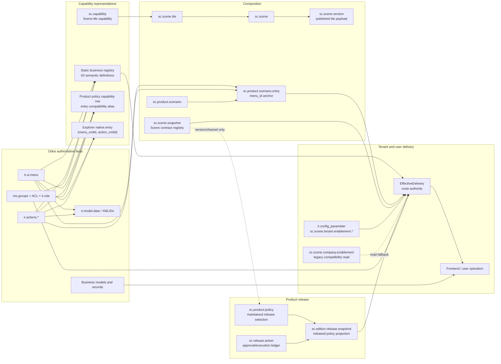

# CP-00 model relationship map

Baseline: `1bfe1f500320a35d59bef156db3c5ba746735668`

This map records current code responsibilities. It is not a proposal to merge
models.

## 1. End-to-end relationship



The dotted Scene snapshot binding is the weak edge: the release stores a
version/channel reference, not the Scene contract bytes or digest.

## 2. Responsibility and enforcement

| Object | Real responsibility | Authority source | Database enforcement | Main consumers | Not responsible for |
| --- | --- | --- | --- | --- | --- |
| `ir.ui.menu` / `ir.actions.*` | Native entry and executable target | Odoo | Odoo relational model | Scenario, product policy, delivery, Explorer | Capability qualification or product release |
| `ir.model.data` | Stable XMLID identity | Odoo | Unique module/name | Explorer, product policy, capability references | Current record existence without database lookup |
| `res.groups`, ACL, `ir.rule` | Authorization facts | Odoo | Native security tables | Delivery gate, model execution | Product enablement or capability maturity |
| Static capability registry | Semantic business capability projection | P1 code | Python definitions only | `system.init.capabilities`, role surfaces | Persisted capability asset |
| `sc.capability` | Scene-tile capability definition | P1 Odoo model | Unique `key`; required tile FK | `sc.scene.tile`, capability APIs | Complete platform capability catalog |
| Product policy capability row | Published entry compatibility alias | P0 product policy JSON | `product_key` unique on policy; row uniqueness is Python preflight | Release snapshot, navigation | Business capability identity |
| Explorer native catalog | Read-only native entry projection | Odoo runtime | None; request-time | Explorer list/detail/diagnose | Editable registry or publication state |
| `sc.product.scenario` | Business Scenario grouping | P1 Odoo model | Unique `code`; immutable code | Tenant activation, navigation, Explorer | Page composition or release |
| `sc.product.scenario.entry` | Native Menu placement in Scenario | P1 Odoo model | Unique `(scenario_id, menu_id)` | Navigation composition, enablement | Action identity or permission grant |
| `sc.scene` | Page composition lifecycle | P1 Odoo model | Unique `code` | Scene release and runtime | Product release decision |
| `sc.scene.tile` | Ordered capability placement | P1 Odoo model | Required Scene and capability FKs | `sc.scene.version` | Qualification evidence |
| `sc.scene.version` | Frozen tile definition at Scene publish | P1 Odoo model | Scene FK; JSON payload | Scene diagnostics / product state | Product snapshot binding by itself |
| `sc.scene.snapshot` | Scene contract registry used by delivery | P0 Odoo model | Declared version key is not DB-unique in model | `SceneService` | Complete product release |
| `sc.product.policy` | Maintained product release selection | P0 Odoo model | Unique `product_key` | Release freeze, Release Operator | Runtime release without snapshot |
| `sc.edition.release.snapshot` | Released product projection | P0 Odoo model | No DB unique active/released constraint; service state machine | Effective delivery, Release Operator | Evidence bundle or full Scene bytes |
| `sc.release.action` | Release/approval audit action | P0 Odoo model | No uniqueness constraint | Release Operator | Independent four-eyes guarantee |
| Runtime tenant parameter | Company enablement decision | P0/P1 runtime config | One parameter key per company/scenario | Navigation filtering | Publication qualification |
| `sc.scene.company.enablement` | Historical enablement carrier | P1 model | Unique `(company_id, scene_key)` | Compatibility read | Sole runtime write authority |

## 3. Duplicate-looking but distinct responsibilities

### `sc.scene` versus `sc.product.scenario`

Keep separate:

- `sc.scene` organizes a capability-composed page.
- `sc.product.scenario` classifies already-authorized native menu entries for
  scenario navigation and tenant enablement.

Evidence:

- `addons/smart_construction_core/models/support/scene_orchestration.py:491`
- `addons/smart_construction_core/models/support/product_scenario.py:56`
- `docs/architecture/scene_layer_responsibility_20261105.md`

### `sc.scene.version` versus `sc.scene.snapshot`

These are not proven duplicates, but their current lives do not connect:

- `sc.scene.version` is produced by Scene publish.
- `sc.scene.snapshot` is consumed by product delivery.
- No current producer maps one to the other.

This is an integration gap, not permission to merge models.

### Product policy versus edition release snapshot

Keep separate:

- product policy is maintained draft selection;
- edition release snapshot is the immutable released projection consumed by
  runtime.

The boundary is correct. The missing enforcement is immutability and complete
dependency capture.

## 4. Native identity versus product identity

Current discovered native identity:

```text
native.entry.<menu_xmlid>.<action_xmlid>
```

Current Scenario identity:

```text
scenario.code
+ native menu_id
```

Current Scene tile identity:

```text
scene.code + capability.key
```

Current release page identity:

```text
page_key (usually menu XMLID) + menu_id + action_id + menu_xmlid + action_xmlid
```

These identities can be related, but no accepted contract yet declares which
one is canonical for a capability asset. This is the first CP-01 decision.
