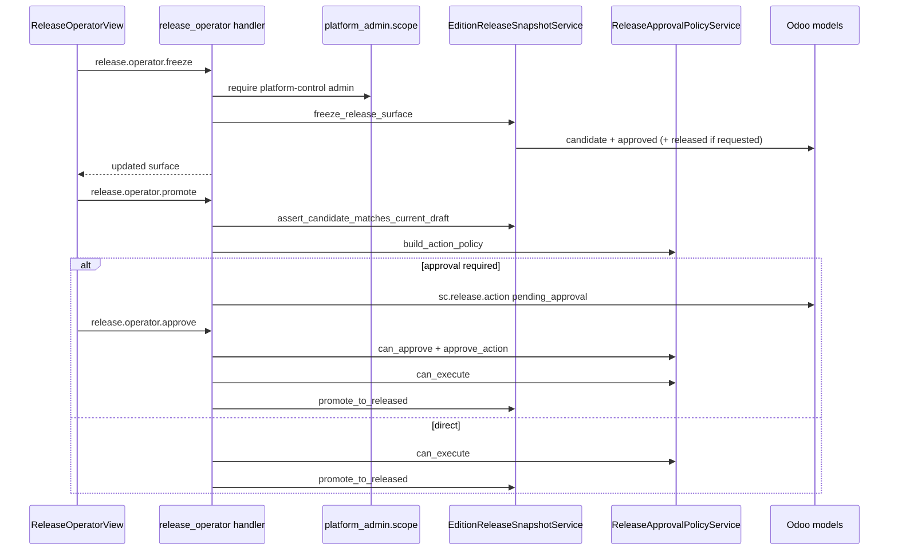
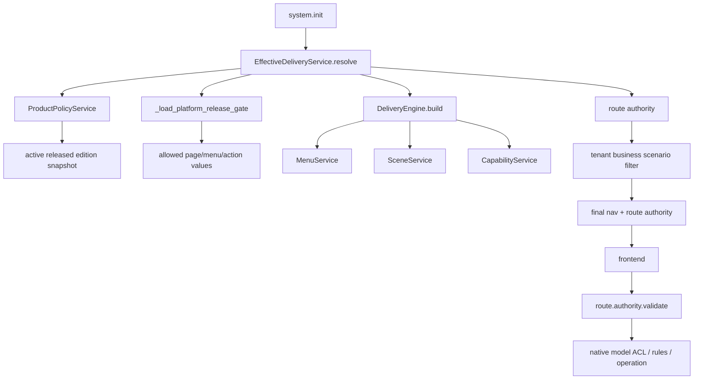
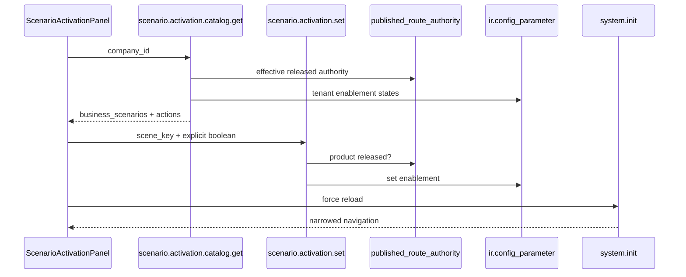

# CP-00 state transitions and API call chains

Baseline: `1bfe1f500320a35d59bef156db3c5ba746735668`

## 1. Lifecycle state machines

### 1.1 `sc.scene`

```text
draft -> published -> archived
published -> published   (a new sc.scene.version becomes active)
```

`action_publish` validates all active visible tiles, creates a new
`sc.scene.version`, sets the active version, then marks the Scene published:

- `addons/smart_construction_core/models/support/scene_orchestration.py:719`

Scene publication is not Product Release. The version defaults to
`product_release_state=PREVIEW`:

- `scene_orchestration.py:883`

No current handler shown in this audit sets `STANDARD_RELEASE` after a
qualification workflow.

### 1.2 `sc.edition.release.snapshot`

```text
candidate -> approved -> released -> superseded
candidate ---------------> released
```

Allowed transitions:

- `addons/smart_core/delivery/edition_release_snapshot_promotion_service.py:19`
- `edition_release_snapshot_promotion_service.py:53`

Rules:

- releasing may supersede the current active released snapshot;
- superseded snapshots are terminal;
- the database does not enforce one active released snapshot per product;
- the service checks and replaces active conflicts.

Evidence:

- `edition_release_snapshot_promotion_service.py:58`
- `edition_release_snapshot_promotion_service.py:96`

The freeze service creates a candidate and immediately promotes it to approved;
when `replace_active=True` it also promotes it to released:

- `addons/smart_core/delivery/edition_release_snapshot_service.py:646`
- `edition_release_snapshot_service.py:745`
- `edition_release_snapshot_service.py:750`

### 1.3 `sc.release.action`

```text
pending -> running -> done
pending -> failed
pending -> canceled

approval_state:
pending_approval -> approved
not_required
```

The action table records the requested product, source/target snapshot,
approval policy, executor, result and diagnostics:

- `addons/smart_core/models/release_management.py:363`
- `release_management.py:384`

Current policy allows self-approval in every action class. No listener checks
whether the approver equals the requester:

- `addons/smart_core/delivery/release_approval_policy_service.py:86`
- `release_approval_policy_service.py:168`

### 1.4 Product policy

```text
draft -> preview -> stable -> archived
```

States are declarations:

- `addons/smart_core/models/release_management.py:14`

Only `preview` and `stable` are releaseable:

- `addons/smart_core/delivery/product_policy_service.py:114`

Editing a published policy is guarded by reconstructing the frozen policy and
checking schema identity:

- `release_management.py:87`

This guard does not make the released snapshot immutable from direct model
writes.

### 1.5 Tenant enablement

```text
not enabled <-> enabled
```

This is independent of product release:

- enable requires released product;
- disable is always allowed;
- disable never deletes native or product facts.

Evidence:

- `addons/smart_construction_scene/services/tenant_scene_activation.py:126`
- `addons/smart_construction_scene/handlers/scenario_activation.py:129`

Runtime write carrier:

```text
ir.config_parameter:
sc.scene.tenant.enablement.<company_id>.<scene_key>
```

Compatibility read:

```text
sc.scene.company.enablement(company_id, scene_key, enabled)
```

### 1.6 User delivery

User delivery is not a stored state. It is computed from:

```text
active released product snapshot
AND tenant enablement
AND native menu/action visibility
AND role/group
AND model ACL
AND record rules
AND company scope
AND business operation validation
```

`EffectiveDeliveryService` builds the navigation and route authority:

- `addons/smart_core/delivery/effective_delivery_service.py:82`

Final execution remains native Odoo:

- `addons/smart_core/delivery/menu_service.py:404`

## 2. Product release call chain

### Custom Release Operator path



Sources:

- `addons/smart_core/handlers/release_operator.py:289`
- `addons/smart_core/handlers/release_operator.py:259`
- `addons/smart_core/handlers/release_operator.py:174`
- `addons/smart_core/handlers/release_operator.py:510`

Important observed behavior:

- freeze marks the candidate approved automatically;
- standard promotion still creates an approval-required release action;
- because the same user can approve their own action, a single
  platform-control admin can complete the custom release path.

### Native Odoo form path

```text
Product Policy form
-> "冻结候选快照"
-> sc.product.policy.action_freeze_candidate()
-> EditionReleaseSnapshotService.freeze_release_surface(replace_active=False)

Release Snapshot form
-> action_approve / action_release / action_supersede
-> EditionReleaseSnapshotPromotionService
```

Sources:

- `addons/smart_core/views/platform_company_access_views.xml:397`
- `addons/smart_core/models/release_management.py:201`
- `addons/smart_core/views/platform_company_access_views.xml:519`
- `addons/smart_core/models/release_management.py:317`

The native buttons do not invoke Release Operator approval, executor-role or
self-approval policy. The model ACL permits `group_smart_core_admin` CRUD:

- `addons/smart_core/security/ir.model.access.csv:14`

This is the highest-priority release-authority inconsistency found by CP-00.

## 3. Effective delivery call chain



Sources:

- `addons/smart_core/handlers/system_init.py:1272`
- `addons/smart_core/delivery/effective_delivery_service.py:82`
- `addons/smart_core/delivery/effective_delivery_inputs.py:179`
- `addons/smart_core/delivery/delivery_engine.py:239`
- `addons/smart_core/delivery/menu_service.py:741`
- `addons/smart_core/handlers/route_authority_validate.py:54`

The same authority is intended for the rendered tree and route validation.
Frontend or tenant scope may narrow it, never invent a route.

## 4. Explorer call chain

```text
PlatformCapabilityExplorerView
-> fetchCapabilityExplorerList / Detail / Diagnose
-> platform.capability.explorer.list | detail | diagnose
-> PlatformCapabilityExplorerHandler
-> capability_explorer_authorization
-> RuntimeCapabilityCatalogService
-> native metadata load
-> extension contributions
-> tokenized projection
```

Sources:

- `frontend/apps/web/src/views/PlatformCapabilityExplorerView.vue:425`
- `frontend/apps/web/src/api/platformCapabilityExplorer.ts:539`
- `addons/smart_core/handlers/platform_capability_explorer.py:30`
- `addons/smart_core/handlers/platform_capability_explorer.py:141`
- `addons/smart_core/delivery/platform_capability_explorer.py:1510`
- `addons/smart_core/delivery/runtime_capability_catalog.py:162`

Explorer authorization accepts either tenant configuration administration or
platform control administration.

Explorer state:

```text
request-time projection
no persistence
no capability registry write
no release/enablement write
```

`catalog_token` is a canonical hash of native and contribution facts. Detail and
diagnose reject a stale expected token:

- `platform_capability_explorer.py:1578`
- `platform_capability_explorer.py:1684`

## 5. Product Scenario and tenant enablement call chain



Sources:

- `frontend/apps/web/src/composables/useScenarioActivation.ts:45`
- `frontend/apps/web/src/composables/useScenarioActivation.ts:79`
- `addons/smart_construction_scene/handlers/scenario_activation.py:74`
- `addons/smart_construction_scene/handlers/scenario_activation.py:95`
- `addons/smart_construction_scene/services/tenant_scene_activation.py:46`

Business release check for a business Scenario:

```text
business_catalog()
-> collect native menus in Scenario
-> keep menus whose published state is released
-> product_released = at least one released menu
```

Source:

- `addons/smart_construction_scene/services/business_scene_enablement.py:21`

This is a partial-member rule, not complete product qualification.

## 6. Scene content and package call chains

### Native Odoo Scene editing

```text
/web action_sc_scene
-> native sc.scene tree/form
-> edit sc.scene.tile
-> action_publish
-> sc.scene.validation + sc.scene.version
```

The native form is restricted to `smart_core.group_smart_core_admin` by action,
menu and model ACL:

- `addons/smart_construction_core/views/support/scene_orchestration_views.xml:180`
- `addons/smart_construction_core/security/ir.model.access.csv:83`

### Modern Scene package intent lane

```text
ScenePackagesView
-> scene.package.list / export / dry_run_import / import
-> ScenePackageService
-> sc.scene.package.installation
-> ir.config_parameter imported scene content
```

Sources:

- `frontend/apps/web/src/api/scene.ts:73`
- `addons/smart_core/handlers/scene_package.py:92`
- `addons/smart_construction_scene/services/scene_package_service.py:450`

This lane imports Scene content. It does not qualify a capability, publish an
edition, enable a tenant or prove user delivery.

### Legacy HTTP Scene package lane

```text
GET  /api/scenes/export
POST /api/scenes/import
```

Both require `user_is_tenant_config_admin` and directly mutate/read
`sc.capability` and `sc.scene`:

- `addons/smart_construction_core/controllers/scene_template_controller.py:443`
- `scene_template_controller.py:604`
- `scene_template_controller.py:82`

The lane has version/checksum/diff safeguards but no product qualification or
edition release. Its co-existence with native Scene forms and modern package
intents is another product assembly fragmentation, not evidence of duplicate
business capabilities.

## 7. Permission checking call chain

```text
permission.check
-> sc.entitlement.get_effective()
-> optional sc.capability.required_flag
-> product availability only
```

`permission.check` explicitly does not authorize record visibility or business
execution:

- `addons/smart_core/handlers/permission_check.py:18`

Final execution:

```text
route authority
-> intent authorization
-> native menu/action group restriction
-> model ACL
-> record rule
-> company scope
-> business method validation
```

This preserves native Odoo as the final authority.

## 8. Call-chain gap register

| Chain | Current status |
| --- | --- |
| Native discovery -> Explorer | PASS |
| Native Menu/Action -> Scenario entry | PASS |
| Scenario entry -> tenant enablement -> route filtering | PASS, with partial-member release limitation |
| `sc.capability` -> `sc.scene` -> `sc.scene.version` | PASS |
| `sc.scene.version` -> `sc.scene.snapshot` -> product policy | GAP: no current producer |
| Acceptance evidence -> Preview/Standard | GAP: evaluator not wired |
| Product policy -> candidate -> released snapshot | PASS |
| Capability dependency/evidence -> release snapshot | GAP |
| Product release -> tenant enablement | PASS as a prerequisite check |
| Tenant enablement -> final user access | PASS as a narrowing filter |
| Platform release -> tenant enablement -> user delivery in one governed UI | GAP |
