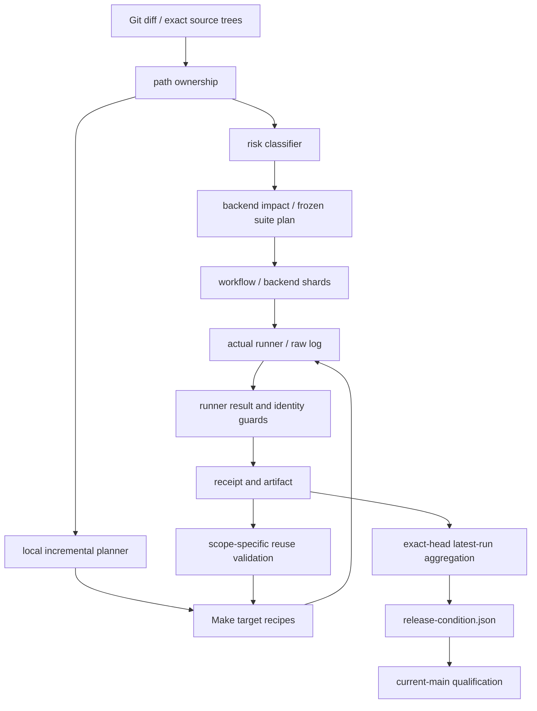

# 验证体系真实责任链

基线 `bfc954c0b6fe2bbaa5a94c017ef8c69ec983d9a5`。状态 VERIFIED 仅指以下调用拓扑和限定实验已核对，不表示所有产品执行路径已验收。

## 三层责任

| 层 | 真实入口与证据 | 不能代替 |
| --- | --- | --- |
| 本地增量 | `ci.local.iteration` → selected run/check states → `frontend_dev_incremental.execute_worktree/execute_targets` → Make → 每目标日志/hash 与 receipt | PR integration 或 main 全量 |
| PR 集成 | ownership/risk → professional/front-end/public → frozen module/shard plan、managed fixture 与四项必需聚合 | 合并后 main 资格 |
| 主线资格 | schedule/operator dispatch 的六工作流 → 完整后端及独立 demo/acceptance → frontend full → release_condition | 部署、任意业务浏览器全量验收 |

`verification_execution_topology.json` 导出 2589 个静态 Make 目标、来源、依赖边、recipe 摘要及 11 条车道的脚本集合。动态入口不会完整出现在静态闭包里。例如 local.iteration 显示 5 个目标，不代表只验证 5 项。该数据只能用于查漏，不能签发执行证明。

## 选测与执行

后端 impact 从精确 Git tree 建模块依赖与输入闭包；测试独有改动可导出类/方法选择，生产代码变化保留所属模块责任。完整套件不能为空，fixture-only 增量产品分区可以明确 not_applicable，fixture 由独立入口承担。`backend_suite_plan.validate_execution_plan` 核对模块集合和分片互斥，`verify_execution_coverage` 比较实际 receipt 的 source/base、非零数量和模块集合。

本地增量规划融合专用规则、路径责任和已登记检查；测试类还从实际文件 AST 读取。因此只给一个不存在的假测试路径，不能证明新增测试选测成功。未知路径会阻断；现有 Node 路由测试也因映射缺失被阻断，见 F05。`producer_target_coverage.json` 区分直接映射、聚合可能覆盖和未知，不把路径匹配当作真实执行。

## 后端证据不能只有总数

`run_changed_odoo_tests.py` 逐模块运行受管 `local.test.test`，输出模块、类数、receipt 引用及最终汇总；`backend_test_receipt.py` 保存源码/模块/数据库/环境/原始日志hash，ORM guard 对照真实 Starting 行、身份和总结；`backend_changed_test_coverage.py` 将 changed class/method 与日志执行关联。Workflow 上传后由 frozen plan coverage 消费。

这些是互补证据，不能把最后一行 `PASS tests=N` 脱离关联 receipt 单独当完整身份。R1 没有写数据库或重跑全模块；本次只通过工具回归和源码接线验证，当前主线完整模块执行为 NOT_VERIFIED。

## 复用并非单一入口

1. `agent_run_context`：已登记检查的输入、声明环境与 runtime readback 校验。
2. `incremental_execution`：内容相同的聚合索引缓存。
3. `resumable_receipt_results`：失败/中断后的逐目标日志复用和依赖失效；通道交接另加 run/channel 条件。
4. `backend_test_receipt` / suite plan：远端 source/workflow/attempt/artifact/context/依赖资格；仅完整满足才授权跳过。

F01 说明不能只检查第 3 条正确就推定第 2 条也正确。`receipt_validity_matrix.json` 把日志完整性与实际复用授权分开；历史成功不自动授予当前 main 发布资格。

## 聚合和效率

远端 release 聚合先选精确 SHA/event/repository/branch 的权威最新 Run，再检查成功；不从历史 Run 补齐缺口。main 生成条件前再回读当前 main。每轮串行查询 4/5 个工作流，最多 1020 轮、间隔 20 秒；工作流本体并行运行。缺工作流有 90 轮宽限，终态失败会提前退出，但只显示第一项失败。

本地主线工具先逐个 dispatch，再按固定六个 Run ID/attempt 核验。dispatch API 串行不等于验证串行；真正可改进的是失败后仍等待、重复查询终态、未输出完整矩阵，以及最终证据/身份核验不足。F02/F03 与远端 shell 不应混为一谈。

## 证据使用与复现

- `failure_replay_matrix.json`：实际隔离负例、既有回归及历史失败的身份/日志/hash。
- `mainline_workflow_matrix.json`：当前 main 的真实 Run/Job 和 #1013–#1018 有限历史；旧主线六工作流成功不转记当前成功。
- `evidence_index.json`：纳入审计提交的原始小日志哈希和本次纯测试日志定位。
- 在本基线上运行 `python3 docs/audit/verify_system_closeout_01/replay.py`、`python3 docs/audit/verify_system_closeout_01/resume_replay.py` 可复现实验。脚本会写当前工作树 `.runtime/verify-system-closeout-01` 和系统临时目录；不改产品、调用真实 GitHub 写 API、访问数据库或创建工作树。若已有同名实验输出，先另存，避免覆盖旧证据。
- 外部 API 故障输入是传输桩；真实 Make/Node/SIGINT 是本地真实子进程。完整远端破坏性故障注入、完整混合业务环境恢复仍为 NOT_VERIFIED。

R2 应把已证实缺陷变成正式受管回归和明确协议，保持契约生产正确、前端忠实消费的验证职责，不重新测试或改造 Odoo 原生权限引擎。
