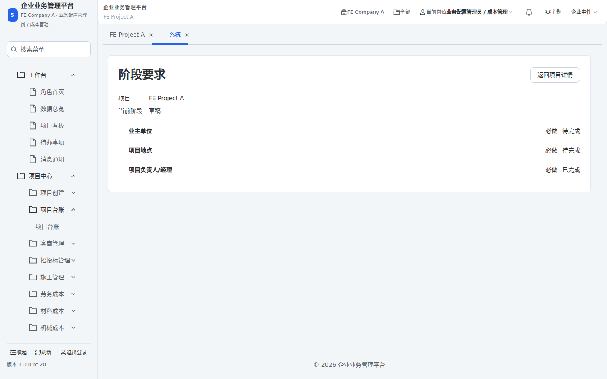

# FEPC-14I：阶段要求只读入口最小实现

本轮只实现已批准的方案 A。无 ACL/record rule、项目阶段、要求项、完成度规则或业务数据变更；未部署日常 Demo，未合并。原生 Odoo 向导保持原样，Vue 入口不再请求创建它。

## 基线与职责

GitHub main / 本地起点：`1e06bcfde151d7669c29825d88c05bf3cd61b455`。实施分支 `fix/fepc-14-readonly-stage-requirements`。批次验证采用该 HEAD 加明确未提交差异，不冒充冻结候选。

最近只读核验的日常 Demo 身份为同一源码 SHA，构建 `03045d0ed5c1359b2e2318be631ac6281bf818c39f272f69bfd62d92ac84c208`，`sc_demo/demo`；详见前置评估采集时间。这不是候选已部署的证明。

- P1 `smart_construction_core`：阶段要求查询、中文标签与项目/阶段身份、Vue 动作目标声明。
- P0 Web：消费明确目标与只读响应，校验项目身份，渲染及沿用错误分类。
- P4：现有 presentation 浏览器入口的有界阶段要求检查，复用隔离环境、凭据、固定 fixture XMLID；不新增数据库、端口、fixture 或浏览器车道。
- 排除：FEPC-13、F1、付款流程、DATA/CFG 及其他既有本地草稿。草稿已独立备份并保存在命名 stash，未纳入产品差异。

## 声明 → 调用 → 消费

1. 原生声明仍为 `action_view_stage_requirements` object 按钮。其原先路径在向导 `create` 处拒绝，见历史复现记录。
2. 现有 P1 `smart_core_normalize_unified_page_contract_v2` 扩展只转换该声明：目标来自当前契约 mainData 的项目 ID，声明 `intent=open` 和只读 URL，清空执行型 button descriptor。保留 native occurrence/backend identity、原可见性和授权结果；无记录 ID 的创建表单及其他动作不变。
3. 新 `project.stage.requirements.read` handler 要求显式正整数项目 ID，经既有 `ProjectAuthorizationService` 按当前用户及服务端公司范围解析；不可访问时抛 AccessError，由原有 dispatcher 返回 403，绝不转为空集合。
4. 读取复用 `project.sc_get_stage_requirements(limit=0)`，保留 read ACL、record rule、当前阶段 active 要求项筛选和 `_sc_is_requirement_done`。0 表示完整集合，不沿用摘要默认前三项。未复制阶段规则，也不发布办理动作。
5. Web 严格校验响应项目身份、标签、阶段、布尔状态及本地返回路径。页面展示加载、真实空结果、内容和返回；ApiError 的 status/reason/trace 原样交给既有 StatusPanel 分类。普通用户不看内部错误消息或堆栈。会话/公司/项目变化清空旧结果，过期响应不提交。
6. 页头与活动页标题取服务端响应 title，不增加前端业务文案。

声明/消费登记于 `frontend_contract_basis_ledger.json`。没有正式协议版本变化、配置发布、模块升级或初始化。

## 验证与证据边界

结果索引为 `.agent/runs/FEPC-14/run.json`，最终冻结 SHA、Quick 和远端结果写 PR/忽略目录回执，不通过改文档反复冻结。

- `make verify.project.stage_requirements.unit`：12 项 Python 用例、11 项 TypeScript 断言；包括真实业务方法的隔离执行、权限检查先于查询、完整集合、异常与空值分离、显式项目 ID、当前动作转换和其他动作不变。
- `make verify.frontend.typecheck.strict`：通过。
- 原生动作守卫 15 项、跨模型导航及错误分类契约守卫：通过。
- `make ci.local.iteration`：L1 通过，不等同于 Quick。
- `make verify.frontend.presentation.local.browser SC_PRESENTATION_SCOPE=stage_requirements`：使用既有隔离库 `sc_frontend_acceptance`，候选挂载、5175/18082；5 项检查通过：真实读取 3 条要求及返回、真实跨公司 403；另有传输模拟空态、断网、500。详见 [implementation-evidence.json](implementation-evidence.json)。未使用挂载另一工作树的 local.dev 作为本候选证据。

**真实浏览器限制**：fixture `FE Project A` 当前为 draft，原声明隐藏“查看阶段要求”。不改阶段、不补数据；真实 API/页面和最终导航声明可以验证，但不能声称已在该样本点击可见按钮。非草稿完整点击仍需在审查后具备相应只读样本的候选环境验证；日常 Demo 的历史403不充当候选成功证据。普通按钮派发和该动作 open_url 计划由既有守卫/定向测试覆盖。

空结果、断网和服务端错误采用浏览器传输层模拟，须与真实后端正常读取及跨公司拒绝分别记录。数据库不因模拟而变化。

## 诊断失败记录

- 第一轮环境别名冲突在浏览器启动前被拒绝；按现有 profile 对齐 URL/数据库别名。
- 草稿样本没有可见按钮，首次等待请求超时；保留未验证的真实点击，不更改可见性规则。
- 直接打开页面后的返回使用服务端 return_path，不携带历史 action/menu；探针原要求完整旧 URL 过严，已按直接入口与按钮入口分别验收。
- 隔离 Vite HMR client 使用旧端口造成控制台连接失败；通过既有 frontend.acceptance down/up 和既有 HMR 参数对齐注册端口，没有改业务服务/数据。

- 首次 Quick 的覆盖守卫拒绝未被调用链引用的新测试 target；已接入现有本地 Quick 与前端 PR/release 单元车道。不修改覆盖基线，不把需要 Node 的测试放入纯后端车道。

## 回滚与剩余风险

本批次只有代码/测试/文档。撤回 P1 action 投影、只读 handler 与前端 route/view 即恢复旧 Vue 行为；不需要数据迁移或权限回滚。旧向导创建403会随代码回滚重新出现。

当前未覆盖日常 Demo 上候选版本的非草稿按钮点击，也未做全角色、全公司、全项目验收。不得以此 PR 宣布部署完成或所有项目阶段验收完成。后续部署必须单独授权；没有为了本任务修改数据库或临时放宽权限。
