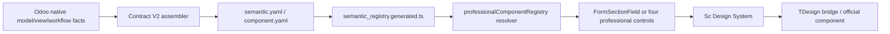

# FE-RENDERER-V1 Closeout

## Identity

- Goal: `FE-RENDERER-V1-CLOSEOUT`
- Branch: `fix/fe-renderer-02c-02b-02-sc-adapter-phase1-20261108`
- PR: #845
- Current product candidate HEAD: `ce9170b4be846c855e9c2a7f536c836542cb82f8`
- Original PR head: `7d3ed98979c17125b3dc987c26fcf6df3f1be701`
- Remote main at start: `f1ba79c173c4701c642b3e505daf33c7aaaedfb9`
- Worktree was clean at the L4 acceptance checkpoint.

## Scope

FE-RENDERER-V1 proves contract-driven uniform TDesign component delivery for the
standard business-page mainline. It does not require all pages to use
`FormSection`, does not turn all 25 `componentKey` values into independent
professional controls, and does not introduce a new renderer runtime.

## Workstreams

- A: Textarea/Input runtime event truthfulness and exact-count Chromium regression.
- B: reconciliation of 25 `componentKey` identities, renderer families,
  implementations and product consumers.
- C: verification of 33 product-required official TDesign component takeovers
  and three real business-page acceptance surfaces.
- Total control: public mapping, registry wiring, integration, evidence and final
  V1 delivery decision.

The delegated executor channel failed to resume after creation and accepted no
work. All scoped work was therefore executed sequentially by total control; no
PASS was inherited from an inactive executor.

## Baseline Facts

- Semantic registry source currently declares 25 component keys.
- The renderer union currently contains five names.
- `FormSectionField` is the generic type-directed sentinel.
- Four independent professional controls exist: BaseField, BusinessValue,
  RelationField and DetailCollection.
- Current driver inventory reports 33 required adapters present, with zero missing,
  bridge-only, raw behavioral or direct vendor-import bypasses.
- PR #845 four required checks succeeded on `7d3ed9897`; that evidence does not
  apply after later edits.

## Results

### V1 delivery chain

The component vocabulary has one declaration authority (`semantic.yaml` and
`component.yaml`), one generated frontend carrier and one runtime resolver. This
closeout does not add a parallel component-key table or a second renderer runtime.

### P0 runtime event closure

The duplicate Textarea `change` was traced to two competing authorities:

- TDesign/ScTextarea emitted a change while the controlled control was still
  handling the edit;
- ScSceneTextarea then synthesized another change from blur.

The scene adapter now owns the native DOM event boundary. It captures `input`
before a controlled driver can restore the old value, emits `update:modelValue`
and `input` only for an actual value transition, and commits `change` against
the last committed value. Real native change and blur cannot both commit the same
edit. No debounce, timer window or value-equality timer is used.

Chromium `147.0.7727.15` real-SFC evidence:

- 37 exact assertions, 0 console errors;
- three typed Input characters produce exactly three `update` and three `input`
  events;
- one Input edit commit produces exactly one `change`;
- one Textarea fill produces exactly one `update`, one `input` and one `change`;
- `update` precedes the committed `change`, and blur does not repeat it;
- disabled/readonly DOM input attempts produce zero model updates;
- native IME `compositionstart`, `compositionupdate` and `compositionend` are
  observed; Input/Textarea `compositionstart`/`compositionend` are forwarded;
- name, inputmode, ARIA, required, error and Textarea element identity remain
  intact.
- if a user draft is replaced by an external controlled `modelValue` update
  before blur, neither Input nor Textarea emits a stale draft `change`; blur
  reports the displayed controlled value.

### First-review follow-up

The first independent review identified two boundaries that were not yet pinned:

- Input/Textarea did not distinguish a user-driven model echo from a genuinely
  external controlled-value reset;
- collection create capability had product behavior but no executable
  missing/false/true regression boundary.

The scene adapters now clear pending user provenance and reset the edit and
committed baselines on every genuinely external value update. On commit, they
use the displayed DOM value only when it is the current controlled value;
otherwise they use the latest user edit, preventing an external server value
from being replaced by a stale draft.

ActionView now delegates create visibility to
`resolveCollectionCreateAuthority`. The helper requires the declared effective
`create=true` capability and one complete authorized `list.create` destination.
Its executable cases cover missing, false and true effective capability; absent
or unauthorized action rules; incomplete action targets; and invalid current
action identity. These cases are wired into the existing
`verify.frontend.action_view_page_actions.unit` target.

The development-incremental route was corrected so ActionView create-boundary
inputs select their executable contract target, and scene text changes select
the real browser behavior target. The routing itself is covered by 87 non-zero
unit tests; this is P4 verification plumbing, not product behavior.

### P1 componentKey reconciliation

The generated platform carrier contains 25 field component keys. `component.yaml`
also contains two node identities (`sc.feedback.message`, `sc.navigation.anchor`);
the semantic lint total of 28 components includes those two node identities plus
the industry payment key. The V1 field reconciliation below is exactly 25 rows.

`FormSectionField` is the type-directed sentinel. It is not one of the four
independent professional controls.

| componentKey | semantic | field types | renderer | actual implementation | TDesign target | product consumer | status |
|---|---|---|---|---|---|---|---|
| `sc.input.text` | text | char | `FormSectionField` -> `ProfessionalBaseFieldControl` | ScInput | TDesignInput | Contract Form FormSection/PBF | ready |
| `sc.input.binary` | binary | binary | `FormSectionField` | ScFileField | TDesignUpload | FormSection binary branch | ready |
| `sc.input.textarea` | long_text | text, html | `FormSectionField` -> `ProfessionalBaseFieldControl` | ScTextarea; RestrictedHtmlEditor for html | TDesignTextarea | Contract Form FormSection/PBF | ready, HTML uses the governed editor |
| `sc.input.number` | number | integer, float, monetary | `FormSectionField` -> PBF for integer/float; sentinel monetary branch | ScNumberInput; ScInput for monetary | TDesignInputNumber; TDesignInput | Contract Form FormSection | ready, split implementation |
| `sc.select.remote` | choice | selection | `FormSectionField` -> PBF | ScSelect | TDesignSelect | Contract Form FormSection/PBF | ready |
| `sc.input.boolean` | boolean | boolean | `FormSectionField` -> PBF | ScCheckbox | TDesignCheckbox | Contract Form FormSection/PBF | ready |
| `sc.input.date` | date | date | `FormSectionField` -> PBF | ScDateField | TDesignDatePicker | Contract Form FormSection/PBF | ready |
| `sc.input.datetime` | datetime | datetime | `FormSectionField` -> PBF | ScDateField `with-time` | TDesignDatePicker | Contract Form FormSection/PBF | ready |
| `sc.table.data` | detail_table | one2many, many2many | `FormSectionField` | generic collection/table path; no dedicated form control | ScTable/TDesignTable on table surfaces | ui.contract.v2 table projection | declared; specialized form consumer not proven |
| `sc.tree.data` | hierarchical_collection | one2many, many2many | `FormSectionField` | no dedicated Contract Form control owned by this key | governed hierarchy surface | hierarchical worksheet contract | declared; not a universal FormSection consumer |
| `sc.relation.many2one` | relation | many2one | `ProfessionalRelationFieldControl` | ProfessionalRelationFieldControl / ProfessionalMany2oneFieldControl -> ScRelationField | TDesignSelect | Contract Form FormSection | ready |
| `sc.relation.many2many` | relation_collection | many2many | `ProfessionalRelationFieldControl` | ProfessionalRelationFieldControl -> X2ManyRelationRenderer | TDesignSelect/Table by relation mode | Contract Form FormSection | ready |
| `sc.relation.table` | detail_collection | one2many | `ProfessionalDetailCollectionControl` | ProfessionalDetailCollectionControl -> X2ManyRelationRenderer | TDesignTable | Contract Form FormSection | ready |
| `sc.select.tags` | tag_collection | many2many | `ProfessionalRelationFieldControl` | X2ManyRelationRenderer -> ProfessionalManyToManySelect | TDesignSelect | formSection.mapper for tag collections | ready |
| `sc.button.action` | action | action | `FormSectionField` | generic action/form-action presentation | ScButton/TDesignButton | Contract action presentation | declared; not a form field edit control |
| `sc.auth.credential_entry` | credential_entry | char | `FormSectionField` | generic field infrastructure; no dedicated current product consumer | ScInput/TDesignInput | declaration-only in current product search | ready identity, consumer pending |
| `sc.auth.secret_confirmation` | secret_confirmation | char | `FormSectionField` | generic field infrastructure; no dedicated current product consumer | ScInput/TDesignInput | declaration-only in current product search | ready identity, consumer pending |
| `sc.auth.challenge_status` | challenge_status | char, selection, text | `FormSectionField` | generic field infrastructure; no dedicated current product consumer | ScInput/ScSelect | declaration-only in current product search | ready identity, consumer pending |
| `sc.auth.one_time_secret` | one_time_secret | char, text | `FormSectionField` | fail-closed declaration; no editable implementation | none by design | auth backend only in current search | fail-closed |
| `sc.auth.support_action` | support_action | action | `FormSectionField` | generic action infrastructure; no dedicated current product consumer | ScButton/TDesignButton | declaration-only in current product search | ready identity, consumer pending |
| `sc.value.money` | money | monetary | `ProfessionalBusinessValueControl` | ProfessionalBusinessValueControl -> ScMoney/ScInput | no vendor for ScMoney; TDesignInput for edit | Contract Form business values | ready |
| `sc.value.percentage` | percentage | float, integer | `ProfessionalBusinessValueControl` | ProfessionalBusinessValueControl -> ScInput | TDesignInput | Contract Form business values | ready |
| `sc.display.status` | status | selection, char | `ProfessionalBusinessValueControl` | ProfessionalBusinessValueControl -> ScStatusBadge/ScSelect | TDesignTag/TDesignSelect | Contract Form status values | ready |
| `sc.value.duration` | duration | float, integer | `ProfessionalBusinessValueControl` | ProfessionalBusinessValueControl -> ScInput | TDesignInput | Contract Form business values | ready |
| `sc.display.text` | readable_value | `*` | `FormSectionField` | readonly fact or generic ScInput fallback | no vendor for readonly text; TDesignInput when editable | Contract Form facts | ready |

No duplicate componentKey registration was found. The principal remaining
inconsistency is not duplicate vocabulary but split implementation for
`sc.input.number` (number versus monetary) and collection/auth identities whose
consumer is a generic host or declaration-only. V1 must not invent dedicated
controls merely to make every key map one-to-one.

### P2 official TDesign takeover

The authoritative generated inventory is
`docs/frontend_productization/rendering-detail/component-driver-takeover-inventory-v1.json`.
Current result:

- official components inventoried: 71;
- product-required components: 33;
- adapter-present: 33;
- missing: 0;
- bridge-only: 0;
- adapter-unconsumed: 0;
- unassessed required takeover: 0;
- raw behavioral surface: 0;
- direct vendor-import bypass: 0;
- non-required components: 38, not defects and not forcible takeover targets.

The 33 required drivers are:

| official driver | adapter key(s) | production consumer count | status |
|---|---|---:|---|
| alert | ScButton, ScErrorState, ScIcon, ScIconButton, ScInlineState, ScInput, ScTabs | 683 | adapter present |
| badge | ScBadge | 1 | adapter present |
| button | ScButton, ScIconButton, ScTooltip | 463 | adapter present |
| card | ScCard, ScPanel | 87 | adapter present |
| checkbox | ScCheckbox | 14 | adapter present |
| collapse | ScButton, ScCollapse, ScDisclosure | 455 | adapter present |
| date-picker | ScDateField, ScDatePicker | 4 | adapter present |
| descriptions | ScDescriptions | 5 | adapter present |
| dialog | ScDialog, ScIcon, ScIconButton | 109 | adapter present |
| drawer | ScDrawer, ScIcon, ScIconButton | 97 | adapter present |
| dropdown | ScDropdown | 5 | adapter present |
| empty | ScEmptyState | 34 | adapter present |
| form | ScForm, ScFormField, ScFormItem | 29 | adapter present |
| input | ScInput | 62 | adapter present |
| input-adornment | ScInputGroup | 1 | adapter present |
| input-number | ScNumberInput | 1 | adapter present |
| layout | ScLayout | 2 | adapter present |
| list | ScList | 8 | adapter present |
| loading | ScInlineState, ScLoading | 77 | adapter present |
| menu | MenuTree, ScIcon | 78 | adapter present |
| pagination | ScPagination | 1 | adapter present |
| progress | ScProgress | 1 | adapter present |
| radio | ScRadio | 4 | adapter present |
| select | ScRelationField, ScSelect | 46 | adapter present |
| skeleton | ScSkeleton | 1 | adapter present |
| space | ScActionBar | 4 | adapter present |
| table | ScIcon, ScIconButton, ScTable | 118 | adapter present |
| tabs | ScButton, ScIcon, ScIconButton, ScTabs | 541 | adapter present |
| tag | ScStatusBadge | 16 | adapter present |
| textarea | ScTextarea | 8 | adapter present |
| timeline | ScTimeline | 1 | adapter present |
| tooltip | ScTooltip | 1 | adapter present |
| upload | ScButton, ScFileField, ScUpload | 448 | adapter present |

This proves structural takeover and consumer presence. It does not assert that
every prop/event/slot combination of every one of the 33 components has a dedicated
browser test; V1 uses risk-selected behavioral proof for the changed primitive
family and shared adapter contracts.

### P3 real business-page acceptance

All three pages ran against the managed isolated Acceptance profile:

- project `sc-fe-r2-p1-01`;
- database `sc_frontend_acceptance`;
- backend port `18082`;
- standard preview `5180`;
- backend and preview both bound to the product candidate.

The fixture password was supplied through the existing Make secret variable and
was not written to the report, run record or logs.

| sample | governed evidence | result |
|---|---|---|
| Contract Form | `verify.frontend.contract_form_presentation.browser` | PASS: `sc.general.contract/2`, action 758/menu 664, 1440/1024/768/390, 0 overflow, 0 console/page/http errors |
| Payment Request | `verify.frontend.business_entry.payment_request.browser` | PASS: `FE-DELIVERY-HARDENING-001`, two declared settlement rows, inline edit 200→150 persisted, restored to row count 0 / amount 20.00, 0 problems |
| Scene Collection | `verify.frontend.list_surface_structure.browser` | PASS: full list matrix, 18 normal/batch/empty × viewport states, 0 failures |
| Scene Collection table identity | `verify.frontend.business_entry.matrix.browser` | PASS: project ledger menu 382/action 590, four rows, row search/detail contract, declared and observed create=false, edit=true, negative authority retained |

Machine evidence:

- `.runtime/final-acceptance/contract-form-presentation/contract/summary.json`
  and four viewport PNGs;
- `.runtime/final-acceptance/payment-request/ce9170b4b/report.json` and
  `after-save.png`;
- `.runtime/final-acceptance/list-surface-structure.json` and its 18 screenshots;
- `.runtime/final-acceptance/scene-collection-table/ce9170b4b/summary.json`.

Two reproducible product defects were found and fixed during L4:

1. collection create was rendered from `list.create` even when the runtime
   effective record capability declared `create=false`;
2. the controlled list search listened only to `input`, so a driver that emitted
   `update:modelValue` rolled typed text back to empty and prevented empty-state
   search.

Neither fix changes ACL, Contract V2 or business data authority.

### P4 architecture and duplication audit

- Contract V2 remains the runtime authority; no Contract V2 rewrite was made.
- The frontend semantic vocabulary remains generated from the declaration files;
  no second componentKey list was added.
- `FormSectionField` remains the explicit generic sentinel; the four independent
  professional controls remain BaseField, BusinessValue, RelationField and
  DetailCollection.
- No required official driver is missing, bridge-only or raw.
- Reused Sc adapters across multiple TDesign drivers (for example ScButton across
  alert/button/collapse/tabs/upload) are shared semantic adapters, not duplicate
  registries.
- The legacy `SceneUiProvider` remains the scene-composition host and still has
  active consumers in `ContractFormDriverHost`, `SceneReadonlyCollectionRenderer`
  and `@sc/ui` scene surfaces. No zero-consumer deletion is justified.
- `ContractFormPage` still has the canonical/legacy selection boundary around
  `canonicalProductRendererActive`; consolidating it is excluded as
  `FE-FORM-CONSOLIDATION-01`.
- Page Assembly, ActionView and HomeView remain independent follow-ups:
  `FE-PAGE-01`, `FE-ACTION-01`, `FE-HOME-01`.

### Current acceptance state

L4 product acceptance passed on historical product candidate `ce9170b4b`.
The first-review follow-up changes Input/Textarea state handling and the
ActionView create decision, so this evidence is not inherited by the follow-up
candidate. Overall V1 remains `verification_pending` until affected-page
revalidation, exact-head publication and fresh remote checks complete.

The final affected incremental iteration passed all 14 required targets with
non-zero execution:

- Agent ledger;
- Agent resume;
- ActionView create authority;
- ActionView page-size runtime;
- ActionView surface gate;
- Contract-basis unit and enforce;
- Development-incremental routing unit;
- frontend lint;
- page-pattern reference parity;
- Primitive Adapter;
- Primitive Port;
- Scene Primitive Adapter;
- real Scene Primitive behavior;
- style-system guard;
- strict UI/web typecheck.

Receipt:
`.runtime/frontend-dev-validation/executions/20261108T133423Z-996104-62656813/receipt.json`.

The frontend production build also passed: 5,373 modules transformed in 25.72
seconds. The existing large-chunk advisory remains.

Affected L4 revalidation is currently `not_run`: the current process did not
contain the managed `SC_ACCEPTANCE_FIXTURE_PASSWORD` injection. No password was
printed, guessed or written. This is an environment prerequisite, not a product
failure, and it prevents carrying the historical three-page pass into this
candidate.

## Exclusions

Page Assembly, ActionView, HomeView and legacy/canonical form consolidation are
registered follow-up work, not V1 blockers.

## Next Exact Step

Run the governed incremental gate on the review follow-up, revalidate the
affected business-page boundaries on its exact code, then publish the same PR
HEAD and obtain fresh required checks.
